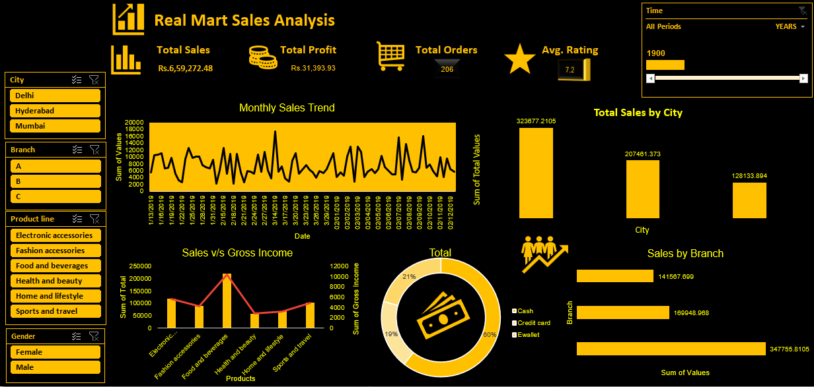

# Real-Mart Sales Analysis Dashboard (Excel)

## Project Overview
This project presents an interactive sales analysis dashboard built in Microsoft Excel. It brings key sales metrics and comparisons into one view to make business performance easier to explore.

## Dashboard Highlights
- Total Sales
- Total Profit
- Total Orders
- Average Rating
- Monthly sales trend
- Sales comparison by city and branch
- Sales versus gross income by product category
- Payment method distribution
- Filters for city, branch, product line, gender, and time period

## Dashboard Preview

## Tools
- Microsoft Excel
- Excel charts and dashboard layout
- Interactive filters/slicers (as shown in the dashboard)

## Key Learning
This project helped me practice organizing sales data, summarizing key performance indicators, comparing categories, and presenting business information through a dashboard.

## Files
- `dashboard-screenshot.png` — preview of the completed dashboard
- Add the Excel workbook (`.xlsx`) to this repository if you want others to inspect the workbook and interact with the dashboard.

## Notes
This repository currently contains the dashboard screenshot and project documentation. The source Excel workbook has not been included yet.
